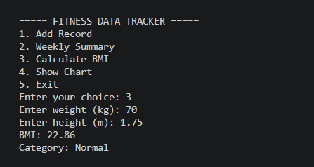
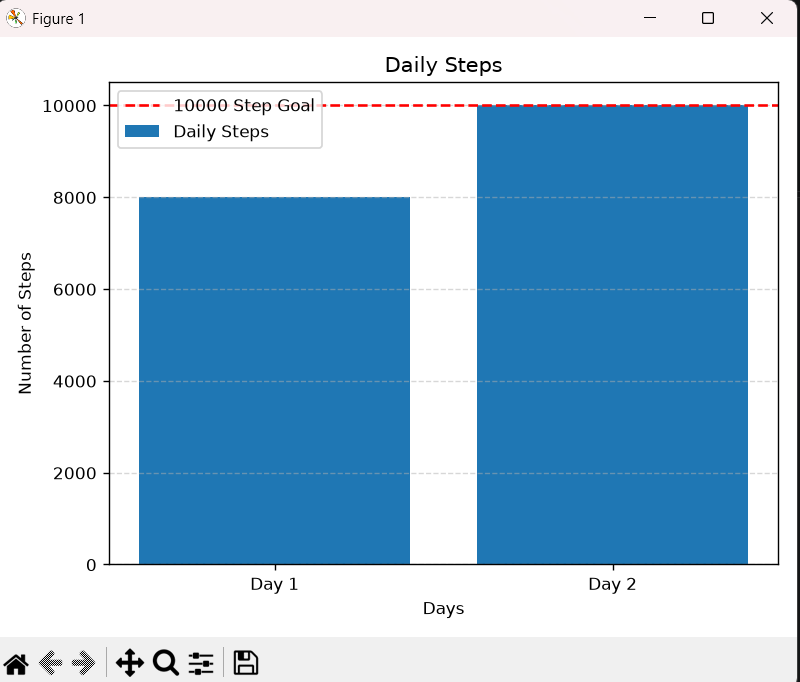
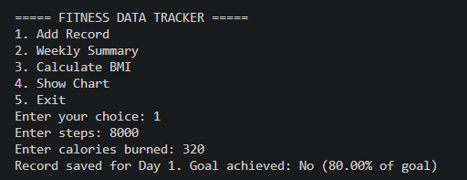
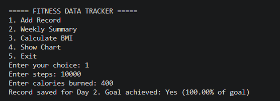
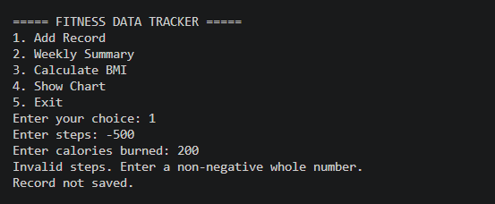
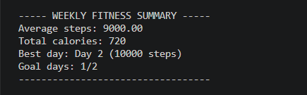

# Fitness Data Tracker

## Project Information

- **Project Title:** Fitness Data Tracker
- **PS Number:** 62
- **University:** Rungta International Skills University
- **School:** School of Computer Science and Engineering
- **Course:** Bachelor of Technology (B.Tech)
- **Branch:** Computer Science and Engineering
- **Semester:** First Semester
- **ERP:** RU-26-00568
- **Programming Language:** Python 3

## 1. Introduction

Fitness Data Tracker is a Python-based application designed to record and analyze daily fitness activities.

It allows users to track their daily steps, calories burned, calculate Body Mass Index (BMI), monitor their fitness goals, and view a weekly summary using a bar chart.

## 2. Problem Statement

To create a program that records daily fitness data (steps and calories burned), checks whether the daily step goal is achieved, calculates BMI, and displays a weekly summary with a bar chart of daily steps.

## 3. Objectives

- Record daily steps and calories burned.
- Set a daily target of 10,000 steps.
- Check whether the daily step goal is achieved.
- Calculate average daily steps.
- Calculate total calories burned.
- Identify the best day based on steps.
- Calculate BMI and display its category.
- Visualize daily steps using a bar chart.

## 4. Technologies Used

- Python 3
- Matplotlib
- Visual Studio Code

## 5. Features

1. **Add Record:** Enter daily steps and calories burned.
2. **Weekly Summary:** Display average steps, total calories, best day, and goals achieved.
3. **BMI Calculator:** Calculate BMI using weight and height.
4. **Fitness Chart:** Display a bar chart of daily steps with a 10,000-step goal line.
5. **Input Validation:** Prevent invalid negative values and handle incorrect inputs.

## 6. BMI Categories

| BMI Range | Category |
|---|---|
| Below 18.5 | Underweight |
| 18.5 – 24.9 | Normal |
| 25 – 29.9 | Overweight |
| 30 and above | Obese |

## 7. Installation and Setup

### Step 1: Install Python

Download Python from:
https://www.python.org/downloads/

### Step 2: Install Matplotlib

Open the terminal and run:

```bash
pip install matplotlib
```

### Step 3: Run the Project

Navigate to the project folder and execute:

```bash
python fitness_tracker.py
```

## 8. Project Structure

```text
Fitness_Data_Tracker/
│
├── fitness_tracker.py
├── README.md
└── screenshots/
    ├── menu.png
    ├── summary.png
    └── chart.png
```

## 9. Sample Test Data

| Day | Steps | Calories |
|---|---:|---:|
| Day 1 | 8000 | 320 |
| Day 2 | 12000 | 480 |
| Day 3 | 10000 | 400 |

### Expected Summary

- Average Steps: 10000.00
- Total Calories: 1200
- Best Day: Day 2 (12000 steps)
- Goals Achieved: 2/3


## 10. Output Screenshots

### 1. BMI Calculator


### 2. Fitness Chart


### 3. Test Case 01 - Normal Input


### 4. Test Case 02 - Minimum Input


### 5. Test Case 03 - Invalid Input


### 6. Test Case 04 - Weekly Summary



## 11. Concepts Used

- Python Lists
- Functions
- Loops
- Conditional Statements
- Exception Handling
- Mathematical Calculations
- Data Visualization

## 12. Conclusion

The Fitness Data Tracker project provides a simple way to monitor daily fitness activities. It helps users track their steps, calories burned, BMI, and daily fitness goals.

This project demonstrates the practical application of Python programming concepts such as lists, functions, calculations, and data visualization.

## 13. Author

**Uday Kumar**

B.Tech – Computer Science and Engineering  
First Semester  
Rungta International Skills University
